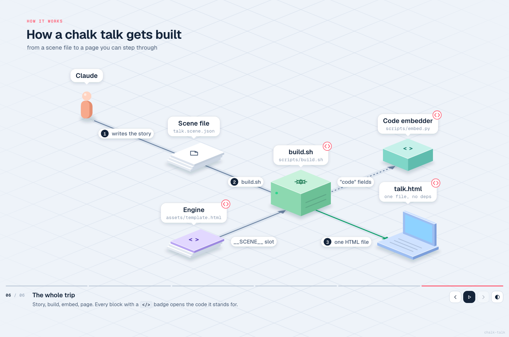
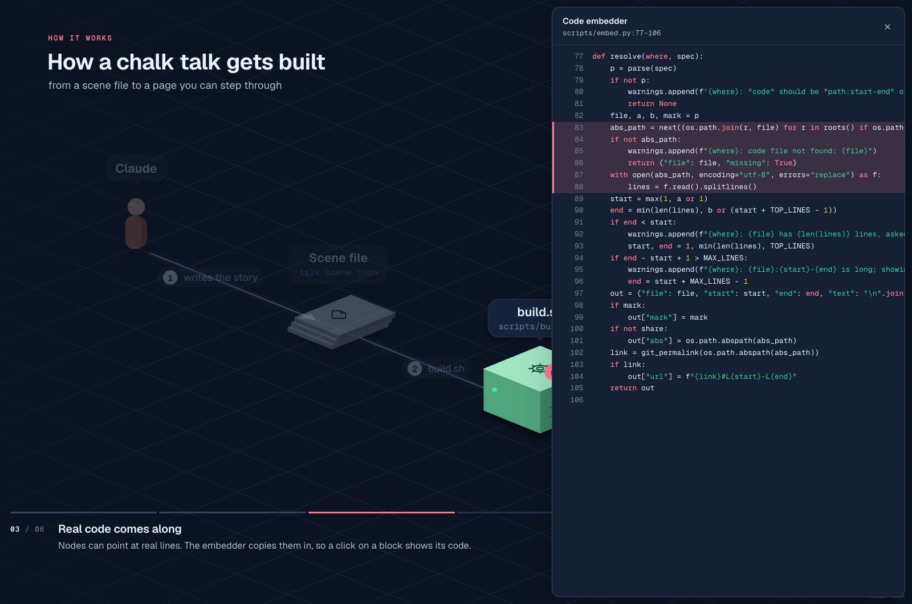
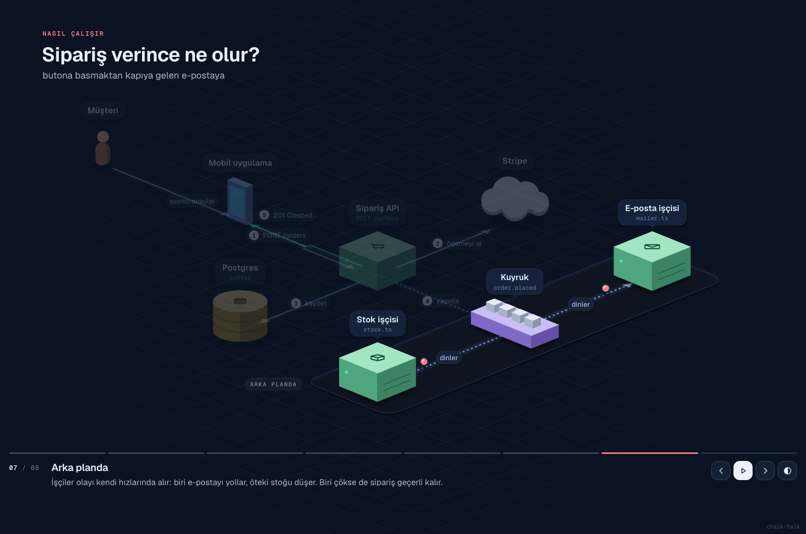
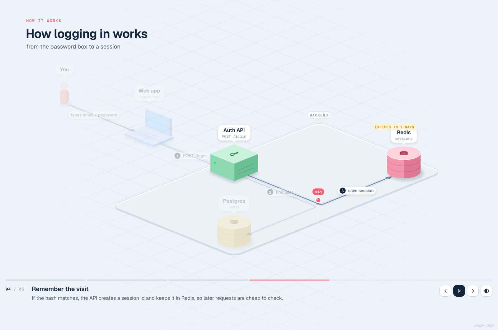
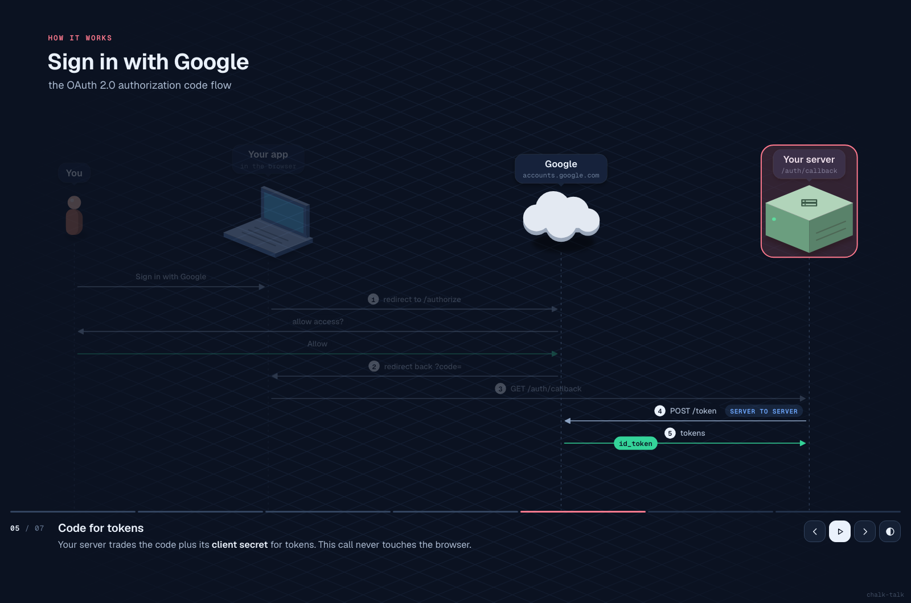
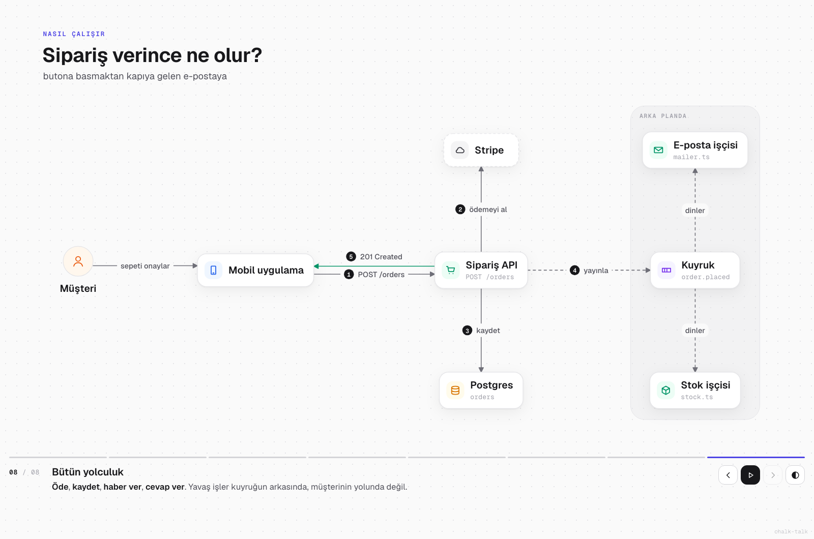

<div align="center">

# chalk-talk

**Ask Claude "how does this work?" and get a little animated diorama of your system, not a wall of text.**

[Live demos](#live-demos) · [Install](#install) · [Use](#use) · [How it works](#how-it-works) · [Scene format](skills/chalk-talk/references/scene-spec.md)

   



</div>

chalk-talk is a [Claude Code](https://claude.com/claude-code) skill. It reads your code, picks one
journey through it ("a user logs in", "an order becomes an email") and turns it into **one HTML
page** you step through like someone explaining at a whiteboard: servers, databases, queues,
laptops and people drop onto an isometric floor one by one, named packets (`JWT`, `order #42`,
`SELECT`) hop along the paths, and a one-line caption says what just happened *and why it
matters*.

And every block can open the real code behind it.

## Click a block, see the code



When Claude reads your code to explain it, it writes down the file and lines behind each part.
The build copies those lines into the page, so every block with a `</>` badge opens its code:
syntax-highlighted, the important lines marked, a **GitHub permalink** to the exact commit and an
**open in VS Code / Cursor** link on your machine. The diagram stops being a picture of the system
and becomes a map into it. That's onboarding in five minutes.

The page is still one file. Send it to anyone; it works offline, no server, no build step.

## Live demos

| talk | what it shows |
|---|---|
| [How a chalk talk gets built](https://oztrkemree.github.io/chalk-talk/skills/chalk-talk/examples/build.html) | this repo explaining itself; click the blocks for the code |
| [How logging in works](https://oztrkemree.github.io/chalk-talk/skills/chalk-talk/examples/login.html) | password → hash check → session → cookie |
| [Sign in with Google](https://oztrkemree.github.io/chalk-talk/skills/chalk-talk/examples/oauth.html) | OAuth 2.0 as a sequence, message by message |
| [Sipariş verince ne olur?](https://oztrkemree.github.io/chalk-talk/skills/chalk-talk/examples/siparis.html) | an order flow with a queue and workers, in Turkish |

`→` / `space` steps forward, `P` plays it, `T` flips light and dark.

<table>
<tr>
<td></td>
<td></td>
</tr>
<tr>
<td align="center"><sub>Dark theme: packets hop from the queue to the workers.</sub></td>
<td align="center"><sub>One point per step; what came before fades back.</sub></td>
</tr>
<tr>
<td></td>
<td></td>
</tr>
<tr>
<td align="center"><sub>Sequence layout for handshakes, OAuth, webhooks.</sub></td>
<td align="center"><sub>Flat <code>"style": "studio"</code> for bigger systems.</sub></td>
</tr>
</table>

## Why

Architecture diagrams show everything at once and leave you the hard part: where do I start?
A person at a whiteboard doesn't do that. They draw the first box, say one sentence, draw the
arrow, point at it. chalk-talk copies that:

- **Builds up.** Each step adds one thing and makes one point. The last step replays the whole trip.
- **Shows movement.** Named packets travel the paths in order, so you see *what* moves, not just that something does.
- **Points.** The new part is at full strength, the rest fades, a glowing ring marks what to look at.
- **Real names.** Labels say what a person would say; the monospace line under them is the real file, endpoint or table.
- **Real code.** Blocks open the exact lines they stand for.
- **Clean by construction.** Claude never writes SVG. It writes a short scene file; the engine does layout,
  arrow routing, label placement and collision checks, then screenshots every step so Claude can
  look at it before you do.

## Install

As a Claude Code plugin:

```
/plugin marketplace add oztrkemree/chalk-talk
/plugin install chalk-talk@chalk-talk
```

Or copy the skill by hand:

```bash
git clone https://github.com/oztrkemree/chalk-talk
cp -r chalk-talk/skills/chalk-talk ~/.claude/skills/
```

## Use

Just ask, in any language:

> how does auth work in this repo?
>
> walk me through what happens when a webhook arrives
>
> bu kuyruk sistemi nasıl çalışıyor, çizerek anlat

or call it directly: `/chalk-talk the checkout flow`.

Claude writes `chalk-talks/<name>.scene.json`, builds `chalk-talks/<name>.html` next to it, checks
every step as a screenshot and opens it. Keep the scene file: ask for changes ("split step 3",
"show the retry path") and Claude edits it.

| key | does |
|---|---|
| `→` / `space` / click | next step |
| `←` | previous step |
| `P` | autoplay |
| `T` | light ↔ dark |
| `C` / click a `</>` block | show the code behind it |
| `1`–`9` | jump to a step (also `#3` in the URL) |

On a phone the board turns portrait and follows the part each step is about.

## How it works

```
your question ──▶ Claude reads the code ──▶ scene.json ──▶ build.sh ──▶ talk.html
                                                 ▲                            │
                                                 └──── check.sh: report + PNG per step
```

A scene is plain JSON: nodes on a coarse grid, edges between them, and steps that say what to
show, what flows and what to say:

```json
{
  "title": "How logging in works",
  "nodes": [
    { "id": "web", "kind": "browser", "label": "Web app", "at": [0, 0] },
    { "id": "api", "label": "Auth API", "sub": "POST /login", "icon": "key", "at": [1, 0],
      "code": "src/auth/login.ts:12-40" }
  ],
  "edges": [{ "id": "req", "from": "web", "to": "api", "label": "POST /login", "packet": "email, pw" }],
  "steps": [
    { "title": "The request", "say": "The web app sends both to the **Auth API**.", "show": ["req"], "flow": ["req"] }
  ]
}
```

The engine (one HTML template, no dependencies) then:

- projects the grid onto an isometric floor and draws each node as a 3D object, back to front,
- routes every path along the floor axes (straight, L or Z), skipping routes that cut through a block,
- places labels and notes where they cover nothing, and wraps long labels when the board gets tight,
- reports what it couldn't fix (`arrow api -> db runs through cache`) so Claude changes the scene.

Nine kinds of blocks (service, database, queue, cloud, laptop, phone, file, person...), 37 icons,
a sequence layout for message exchanges, and three flat styles for big systems: **studio**,
**blueprint** and **editorial**. Everything is in the
[scene reference](skills/chalk-talk/references/scene-spec.md).

## Build a talk by hand

You don't need Claude to use the engine:

```bash
skills/chalk-talk/scripts/build.sh my-talk.scene.json   # writes my-talk.html
skills/chalk-talk/scripts/check.sh my-talk.html         # layout report + a PNG per step
```

`build.sh` needs `bash` and `awk`, plus `python3` to embed `code` snippets. `check.sh` needs Chrome,
Chromium, Edge or Brave (`CHROME=/path` if it isn't found). Pages load their fonts from Google
Fonts and fall back to system fonts offline.

Sending a page to someone else? `CHALK_SHARE=1 build.sh ...` leaves your local file paths out;
GitHub permalinks stay.

## Credits

- Fonts: [Geist](https://vercel.com/font) by Vercel, [IBM Plex](https://www.ibm.com/plex/) by IBM,
  [Inter Tight](https://rsms.me/inter/) by Rasmus Andersson and
  [Newsreader](https://fonts.google.com/specimen/Newsreader) by Production Type, all under the
  SIL Open Font License, loaded from Google Fonts and not bundled.
- The step-through idea owes a lot to Nicky Case's explorable explanations and Julia Evans' zines.

## License

[MIT](LICENSE). Use it, fork it, ship it.
