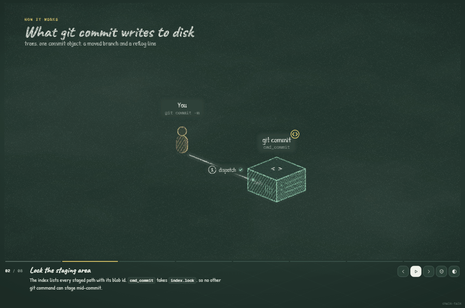
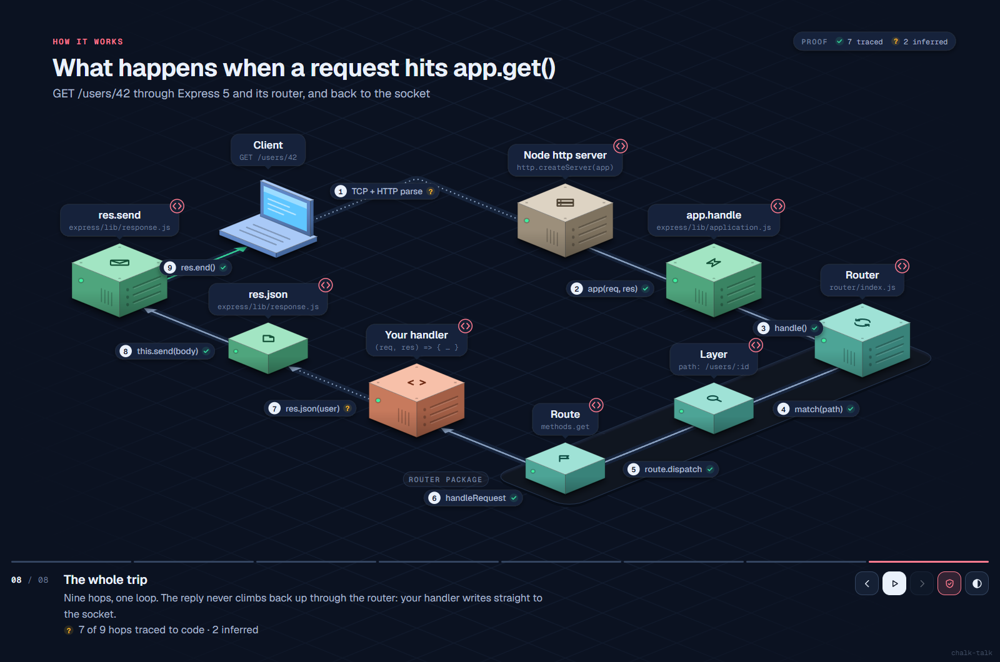
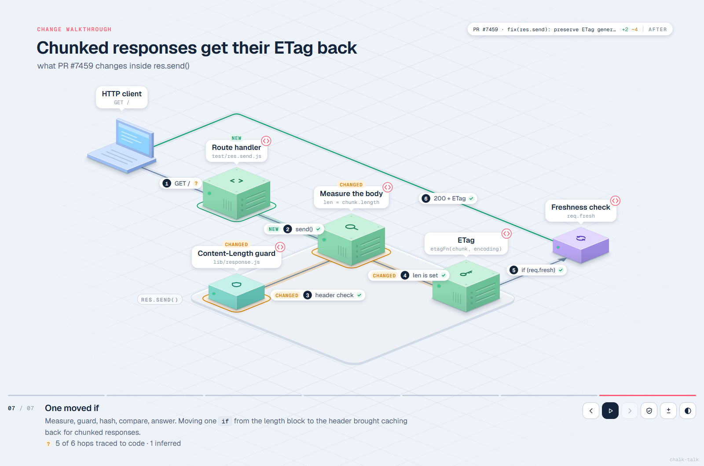

<div align="center">

# chalk-talk

### 别看地图，看它跑一遍。

问你的编程 Agent 一句 *“这是怎么运作的？”*，它会把真实的代码路径做成一段分步动画讲解，装进一个 HTML 文件里。**每一个箭头都对应到它实际发生的那一行代码**，对不上的就老老实实标成推测。

[**在线站点与示例**](https://oztrkemree.github.io/chalk-talk/) · [安装](#安装) · [证明](#每个箭头都有出处) · [讲解 PR](#讲解-pull-request) · [场景格式](../../skills/chalk-talk/references/scene-spec.md)

   

[English](../../README.md) · 简体中文 · [日本語](README.ja.md) · [한국어](README.ko.md) · [Español](README.es.md) · [Türkçe](README.tr.md)



<sub>`git commit`，直接从 git 自己的源码讲起。9 跳中 9 跳都追溯到了代码。<a href="https://oztrkemree.github.io/chalk-talk/gallery/git-commit/git-commit.html?style=chalk">在线打开 →</a></sub>

</div>

## 为什么

架构图和知识图谱告诉你**有什么**。可当你刚接手一个代码库，或者对着一个 AI 写的 PR 发愣时，你真正想知道的是：**发生了什么、按什么顺序、在代码的哪一行**。

chalk-talk 的回答方式，就像一位优秀的工程师站在白板前：一次只讲一件事。先画第一个方框，配一句话，再画一个箭头，让一个数据包沿着它移动（“`JWT`”、“`order #42`”、“`SELECT`”）。之前的部分淡出，新的部分被点亮。最后整条路径完整回放一遍。点击任意方块或箭头，就能打开对应的代码行，附带 GitHub 永久链接。

你的 Agent 只需要写一个很小的场景文件。布局、连线、3D 绘制和动画全交给引擎，它还会把每一步都截图，让 Agent 在你看到之前先自查一遍。

## 每个箭头都有出处

画错的动画图比没有图更糟：它是一种*更有说服力*的幻觉。所以在 chalk-talk 里，箭头不只是画出来的，而是**有出处的**：

```json
{ "from": "router", "to": "layer", "label": "match(path)",
  "code": "router/index.js:230-247", "calls": "matchLayer(layer, path)" }
```

构建时会打开文件、读取这几行，检查 `matchLayer(layer, path)` 是否真的在那里。然后给每个箭头打上标记：

| 标记 | 含义 |
|---|---|
| ✓ **verified**（已验证） | 引用的代码行存在，并且包含该调用 |
| **?** **inferred**（推断） | 没有可以指向的代码行（网络边界、动态分发），并注明原因 |
| **!** **broken**（失效） | 这些行里找不到该调用。构建会报警告，Agent 负责修好 |

```
$ node scripts/build.mjs express-request.scene.json
proof: 7/9 hops traced to code (7 verified, 0 cited) · 2 inferred · 0 broken
```

在任意讲解中按 **`V`** 就能看到哪些跳已被证明。结尾的回顾也会直接说出来：*“7 of 9 hops traced to code · 2 inferred”*。



## 示例集

下面每一段讲解都是 Agent 根据真实源码写出来的，每个箭头都经过检查。

| 讲解 | 仓库 | 证明 |
|---|---|---|
| [git commit 往磁盘写了什么](https://oztrkemree.github.io/chalk-talk/gallery/git-commit/git-commit.html) | git/git | 9/9 已追溯 |
| [Codex CLI 如何执行一条 shell 命令](https://oztrkemree.github.io/chalk-talk/gallery/codex-exec/codex-exec.html) | openai/codex | 10/10 已追溯 |
| [Vite 如何热更新一个模块](https://oztrkemree.github.io/chalk-talk/gallery/vite-hmr/vite-hmr.html) | vitejs/vite | 7/8 已追溯，1 处推断 |
| [Redis 收到 `SET greeting hello` 后做了什么](https://oztrkemree.github.io/chalk-talk/gallery/redis-set/redis-set.html) | redis/redis | 8/9 已追溯，1 处推断 |
| [FastAPI 如何调用你的函数](https://oztrkemree.github.io/chalk-talk/gallery/fastapi-request/fastapi-request.html) | fastapi/fastapi | 8/9 已追溯，1 处推断 |
| [请求到达 `app.get()` 时发生了什么](https://oztrkemree.github.io/chalk-talk/gallery/express-request/express-request.html) | expressjs/express | 7/9 已追溯，2 处推断 |
| [PR #7459：分块响应重新带上 ETag](https://oztrkemree.github.io/chalk-talk/gallery/express-pr/express-pr.html) | expressjs/express | 5/6 已追溯，1 处推断 |
| [chalk-talk 如何证明每一个箭头](https://oztrkemree.github.io/chalk-talk/skills/chalk-talk/examples/build.html) | 本仓库 | 6/7 已追溯，1 处推断 |

`→` / `space` 下一步，`P` 播放，`V` 证明视图，`T` 切换亮/暗，点击方块或箭头查看对应代码。

## 讲解 Pull Request

> 用 chalk talk 讲解一下这个 PR

Agent 会读取 diff，**按改动之后的样子**讲完整条路径，并把变化之处高亮出来：`NEW`、`CHANGED`、`REMOVED`，一个 `PR #7459 · +2 ~4` 标签，还能按 **`D`** 在改动前后之间切换。把 GIF 放进 PR 描述里，评审者还没读代码就已经看懂了改动。



## 安装

**Claude Code**

```
/plugin marketplace add oztrkemree/chalk-talk
/plugin install chalk-talk@chalk-talk
```

**Codex、Cursor、Gemini CLI、OpenCode、Copilot 以及[其他 40 多种 Agent](https://agentskills.io)**

```bash
npx skills add oztrkemree/chalk-talk
```

**手动安装**：把 `skills/chalk-talk` 复制到你的 Agent 的 skills 目录（`~/.claude/skills/`、`~/.codex/skills/`……）。

脚本需要 Node 18+（Windows、macOS、Linux）。可视化自检会使用你已安装的任意一个 Chrome、Edge、Brave 或 Chromium。

## 使用

直接问就行，用什么语言都可以：

> 这个仓库的鉴权是怎么做的？
>
> 带我走一遍：webhook 到达时会发生什么
>
> 用 chalk talk 讲解一下这个 PR

或者直接调用：`/chalk-talk 结账流程`。

Agent 会写出 `chalk-talks/<name>.scene.json`，构建出 `chalk-talks/<name>.html`，把每一步截图检查一遍，然后打开它。场景文件记得留着：想改什么直接说（“把第 3 步拆开”“把重试路径画出来”），Agent 会去改它。

| 按键 | 作用 |
|---|---|
| `→` / `space` / 点击 | 下一步 |
| `←` | 上一步 |
| `P` | 自动播放（URL 里加 `?play=loop` 可循环） |
| `V` | 证明视图：哪些跳已追溯到代码 |
| `D` | 在 PR 讲解中切换改动前 / 后 |
| `C` / 点击方块或箭头 | 查看背后的代码 |
| `T` | 亮色 ↔ 暗色 |
| `1`–`9` | 跳到指定步骤（也可以在 URL 里用 `#3`） |

在手机上，画板会切换成竖屏，并自动跟随每一步讲到的部分。

## 分享

一段讲解就是**一个 HTML 文件**：不需要服务器，离线可用，想发给谁就发给谁。`CHALK_SHARE=1` 会去掉你的本地路径，同时保留 GitHub 永久链接。

想直接嵌进 README、PR 或 Slack？

```bash
node skills/chalk-talk/scripts/record.mjs chalk-talks/auth.html --out auth.gif --style chalk
```

`record.mjs` 会逐帧驱动你已安装的 Chrome（不需要 ffmpeg，也不需要任何 npm 包），输出一个循环播放的 GIF。可选参数：`--steps 2-5`、`--width 960`、`--theme dark`。

## 风格

| | |
|---|---|
| **iso**（默认） | 等距地面上的小 3D 方块；数据包抵达时服务器会闪一下，写入时数据库泛起涟漪，队列会填满再排空 |
| **chalk** | 同一块画板，用粉笔画在石板上：手绘笔触，粉彩排线 |
| **studio** · **blueprint** · **editorial** | 扁平的卡片布局，适合更大的系统 |

在场景里写 `"style": "chalk"`，或者在任意讲解的 URL 后加 `?style=chalk`。

## 原理

```
your question ──▶ agent reads the code ──▶ scene.json ──▶ build.mjs ──▶ talk.html
                                               ▲          (proof check)      │
                                               └──── check.mjs: report + PNG per step
```

场景就是普通的 JSON：粗网格上的节点、节点之间的边（附带证明它们的代码），以及若干步骤，说明要展示什么、什么在流动、要讲什么：

```json
{
  "title": "How logging in works",
  "nodes": [
    { "id": "web", "kind": "browser", "label": "Web app", "at": [0, 0] },
    { "id": "api", "label": "Auth API", "sub": "POST /login", "icon": "key", "at": [1, 0],
      "code": "src/auth/login.ts:12-40" }
  ],
  "edges": [
    { "id": "req", "from": "web", "to": "api", "label": "POST /login", "packet": "email, pw",
      "code": "src/web/login.tsx:31-38", "calls": "fetch('/login'" }
  ],
  "steps": [
    { "title": "The request", "say": "The web app sends both to the **Auth API**.", "show": ["req"], "flow": ["req"] }
  ]
}
```

引擎（一个 HTML 模板，零依赖）会把网格投影到等距地面上，把每个节点画成 3D 物体，让路径绕开方块，把标签放在不遮挡任何东西的位置，并报告它自己修不好的问题（`arrow api -> db runs through cache`），让 Agent 去调整场景。九种方块、37 个图标、一种适合握手和 OAuth 的时序布局、五种风格。所有细节都在[场景参考](../../skills/chalk-talk/references/scene-spec.md)里。

不用 Agent，也可以手动构建一段讲解：

```bash
node skills/chalk-talk/scripts/build.mjs my-talk.scene.json   # writes my-talk.html, checks proof
node skills/chalk-talk/scripts/check.mjs my-talk.html         # layout report + a PNG per step
```

## 常见问题

**它还会出错吗？** 会。Agent 可能挑错了要讲的故事，或者简化过了头。但它没法悄无声息地画出一个声称存在、代码里却没有的调用：那会得到一个 `!` 和一条构建警告。`?` 标记则精确地告诉你，讲解在哪些地方依赖的是判断，而不是某一行代码。

**我的代码会被发到别处吗？** 不会。chalk-talk 是由你的 Agent 在本地运行的 skill。页面就是你磁盘上的一个文件，什么都不会上传。

**大型仓库呢？** 一段讲解只讲一条路径，大约 8 个方块。想看下一条路径，就再要一段讲解。几段小而聚焦的讲解，胜过一张看不懂的大地图。

## 致谢

- 字体：Vercel 的 [Geist](https://vercel.com/font)、IBM 的 [IBM Plex](https://www.ibm.com/plex/)、[Inter Tight](https://rsms.me/inter/)、[Newsreader](https://fonts.google.com/specimen/Newsreader)、[Caveat](https://fonts.google.com/specimen/Caveat) 和 [Patrick Hand](https://fonts.google.com/specimen/Patrick+Hand)，均采用 SIL Open Font License，从 Google Fonts 加载，未打包进项目。
- 分步讲解的思路很大程度上要归功于 Nicky Case 的 explorable explanations 和 Julia Evans 的 zines。

## 许可证

[MIT](../../LICENSE)。随便用，随便 fork，尽管拿去发布。如果它帮你看懂了什么，点个 ⭐ 能让更多人找到它。
